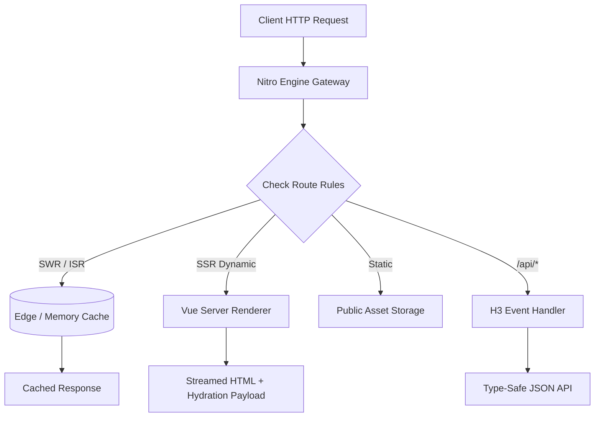

# Vue 3.5 & Nuxt 3/4 Ecosystem: Architecture & Reactive Systems (2026)

> Technical reference for modern Vue 3.5+ core, the Nitro server engine, Nuxt full-stack paradigms, and state management via Pinia.

---

## 1. Vue 3.5+ Core Reactive Architecture

Vue 3.5 introduces deep performance optimizations to its proxy-based reactivity system, including double-ended queue dependency tracking and deferred computeds, reducing reactive memory overhead by over 56%.

### 1.1 Composition API & Reactive Primitives
- **Proxy-Based Interception:** Intercepts `get`, `set`, and `deleteProperty` traps, maintaining a global `targetMap` connecting reactive objects, properties, and subscriber effects.
- **Reactive Props Destructure:** Direct destructuring of `defineProps()` without losing reactivity:
  ```vue
  <script setup lang="ts">
  interface Props {
    title: string;
    count?: number;
    tags?: string[];
  }

  // Reactive prop destructuring with native defaults
  const { title, count = 0, tags = () => [] } = defineProps<Props>();

  // watch automatically observes the destructured prop
  watch(() => count, (newCount) => {
    console.log(`Count changed to: ${newCount}`);
  });
  </script>

  <template>
    <div class="card">
      <h2>{{ title }}</h2>
      <p>Count: {{ count }}</p>
    </div>
  </template>
  ```

### 1.2 Custom Elements & SSR Custom Renderers
Vue 3 provides `@vue/runtime-core` which can be bound to arbitrary targets beyond the DOM (Canvas, WebGL, native mobile, terminal interfaces).

---

## 2. Nuxt 3/4 Full-Stack Architecture

Nuxt provides an end-to-end full-stack web framework built on top of Vite and the **Nitro** server engine.



### 2.1 The Nitro Server Engine
- **Universal Zero-Config Deployment:** Compiles to stand-alone targets: Node.js cluster, Bun, AWS Lambda, Cloudflare Workers, Fastly Compute, or Docker containers.
- **H3 HTTP Framework:** Ultra-lightweight HTTP router and middleware layer with built-in composables (`readBody`, `getQuery`, `setCookie`, `createError`).
- **Storage Layer (unstorage):** Built-in multi-driver abstraction supporting Redis, filesystem, memory, Cloudflare KV, and MongoDB with a single unified API.

### 2.2 Server Routes and Type-Safe Endpoints
```ts
// server/api/users/[id].get.ts
export default defineEventHandler(async (event) => {
  const id = getRouterParam(event, 'id');
  if (!id) {
    throw createError({ statusCode: 400, statusMessage: 'User ID is required' });
  }

  const user = await db.user.findUnique({ where: { id } });
  if (!user) {
    throw createError({ statusCode: 404, statusMessage: 'User not found' });
  }

  return user; // Automatically typed on client fetch
});
```

On the frontend, calling `useFetch('/api/users/123')` provides end-to-end TypeScript type inference without code generation tools or manual schema declarations.

### 2.3 Hybrid Rendering & Route Rules
```ts
// nuxt.config.ts
export default defineNuxtConfig({
  routeRules: {
    // Homepage pre-rendered at build time
    '/': { prerender: true },
    // Product pages cached with Stale-While-Revalidate for 1 hour
    '/products/**': { swr: 3600 },
    // Admin dashboard rendered completely client-side (SPA)
    '/admin/**': { ssr: false },
    // API endpoints with CORS headers enabled
    '/api/**': { cors: true },
  },
});
```

---

## 3. State Management & Composables

### 3.1 Pinia
Pinia replaces Vuex as the official state management library. Key features:
- Zero mutation boilerplate: state is mutated directly or via actions.
- Full TypeScript autocomplete for state, getters, and actions.
- Automatic SSR state hydration and devtools time-travel debugging.

```ts
// stores/cart.ts
import { defineStore } from 'pinia';
import { ref, computed } from 'vue';

export const useCartStore = defineStore('cart', () => {
  const items = ref<Array<{ id: string; name: string; price: number; quantity: number }>>([]);

  const totalCost = computed(() =>
    items.value.reduce((sum, item) => sum + item.price * item.quantity, 0)
  );

  function addItem(item: { id: string; name: string; price: number }) {
    const existing = items.value.find((i) => i.id === item.id);
    if (existing) {
      existing.quantity++;
    } else {
      items.value.push({ ...item, quantity: 1 });
    }
  }

  return { items, totalCost, addItem };
});
```

### 3.2 VueUse Ecosystem
VueUse provides 200+ composables covering:
- Sensors: `useMouse`, `useGeolocation`, `useDeviceOrientation`
- State: `useStorage` (reactive LocalStorage binding), `useRefHistory` (undo/redo stacks)
- Browser: `useClipboard`, `useDark`, `useEventListener`
- Animation & Async: `useTransition`, `useDebounceFn`, `useInfiniteScroll`

---

## 4. Vue/Nuxt vs React/Next Comparison

| Dimension | Vue 3.5 / Nuxt 3/4 | React 19 / Next.js |
|---|---|---|
| **Reactivity Paradigm** | Fine-grained signals / Proxy dependencies | Component re-render reconciliation / Virtual DOM |
| **Boilerplate / Friction** | Minimal (`<script setup>`, auto-imports) | Moderate (explicit imports, hook dependency arrays) |
| **Server Engine** | Nitro (universal cross-runtime abstraction) | Node / Edge runtime specialized |
| **Learning Curve** | Gentle, intuitive progressive enhancement | Steep (RSC boundaries, streaming Suspense) |
| **Enterprise Adoption** | Dominant in European and Asian markets | Dominant in US enterprise and VC startups |
