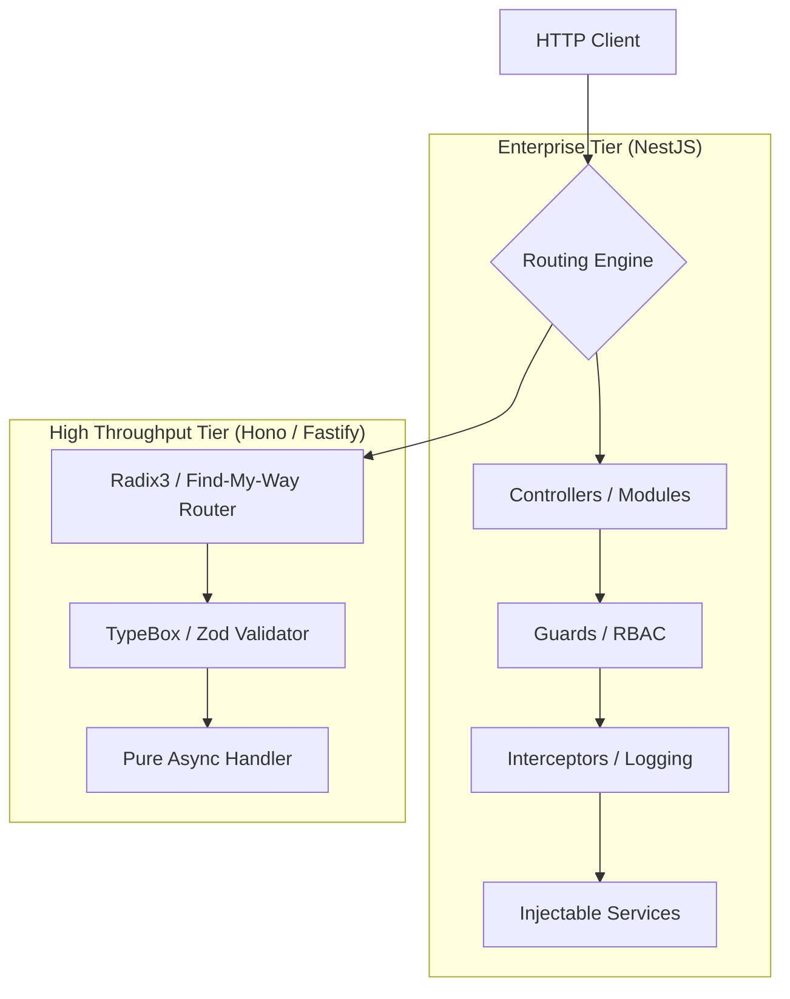

# Modern Node.js & TypeScript Backend Systems: Architecture & Runtimes (2026)

> Technical reference for enterprise TypeScript backends: NestJS, Fastify, Hono, Elysia, and multi-runtime execution (Node 22+, Bun).

---

## 1. Runtime Evolution: Node.js 22+ vs Bun

The JavaScript server runtime landscape has matured into a multi-engine standard:

- **Node.js 22+ (LTS):** Built on V8 with native ESM support, built-in test runner (`node:test`), native WebSocket client, permission security model, and V8 Maglev compiler enhancements.
- **Bun:** Written in Zig with JavaScriptCore engine. Provides ultra-fast startup times, built-in SQLite/PostgreSQL drivers, native bundling, and drop-in Node API compatibility.

---

## 2. Framework Taxonomy & Architectural Paradigms



### 2.1 NestJS: Enterprise Modular Architecture
NestJS mirrors Angular's structural discipline for large-scale enterprise teams:
- **Dependency Injection:** Centralized IoC container managing service lifetimes (`SINGLETON`, `REQUEST`, `TRANSIENT`).
- **Guards & Interceptors:** Declarative route protection via TypeScript decorators (`@UseGuards(JwtAuthGuard)`).
- **Transport Abstraction:** Identical service logic can be exposed via HTTP, GraphQL, WebSockets, or gRPC microservices via `@MessagePattern()`.

```ts
// src/billing/billing.service.ts
import { Injectable, NotFoundException } from '@nestjs/common';
import { PrismaService } from '../prisma/prisma.service';

@Injectable()
export class BillingService {
  constructor(private readonly prisma: PrismaService) {}

  async processInvoice(subscriptionId: string) {
    const sub = await this.prisma.subscription.findUnique({ where: { id: subscriptionId } });
    if (!sub) throw new NotFoundException('Subscription does not exist');
    // Processing logic...
    return { status: 'paid', amount: sub.monthlyRate };
  }
}
```

### 2.2 Hono: The Multi-Runtime Universal Framework
**Hono** has become the primary choice for modern, lightweight, type-safe API microservices across Edge and traditional servers:
- **Zero Dependencies:** Sub-15KB footprint.
- **Universal Portability:** Runs identically on Node.js, Bun, Cloudflare Workers, Deno, and Fastly Compute.
- **RPC Client (Hono RPC):** Allows frontend applications to invoke backend routes with 100% end-to-end type safety without code generation tools.

```ts
// server.ts
import { Hono } from 'hono';
import { zValidator } from '@hono/zod-validator';
import { z } from 'zod';

const app = new Hono();

const userSchema = z.object({
  email: z.string().email(),
  name: z.string().min(2),
});

const routes = app.post('/api/users', zValidator('json', userSchema), async (c) => {
  const data = c.req.valid('json');
  // Persistence logic...
  return c.json({ success: true, user: data }, 201);
});

export type AppType = typeof routes;
export default app;
```

Frontend consumption with `hc` (Hono Client):
```ts
import { hc } from 'hono/client';
import type { AppType } from './server';

const client = hc<AppType>('http://localhost:3000');
// Fully typed request body and response payload
const res = await client.api.users.$post({ json: { email: 'user@example.com', name: 'Alex' } });
const data = await res.json();
```

### 2.3 Fastify: Maximum Performance for Node.js
- **JSON Serialization Optimization:** Uses `fast-json-stringify` which compiles JSON serialization down to targeted V8 functions based on JSON Schema, yielding 2x faster serialization than `JSON.stringify()`.
- **Plugin Architecture:** Encapsulated plugin hierarchy via `fastify-plugin`, preventing scope bleeding.

---

## 3. Real-Time Communication: WebSockets vs SSE

| Pattern | Technology | Directionality | Ideal Use Cases |
|---|---|---|---|
| **Server-Sent Events (SSE)** | Native HTTP/2 Stream | Server-to-Client Unidirectional | AI streaming responses (LLM completions), live dashboards, build logs |
| **WebSockets** | `ws`, `Socket.io`, `uWebSockets.js` | Full-Duplex Bidirectional | Collaborative whiteboards, multiplayer canvas, high-frequency chat |
