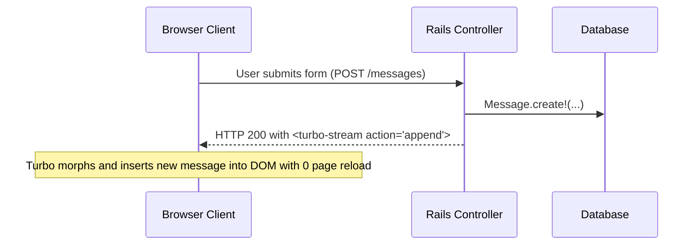

# Ruby on Rails 8: The Modern Majestic Monolith & The Solid Stack (2026)

> Technical reference for Rails 7.2/8: Hotwire (Turbo & Stimulus), Solid Queue, Solid Cache, Solid Cable, and Kamal 2 deployment.

---

## 1. The Rails 8 Architectural Renaissance

Rails 8 formalizes the "Majestic Monolith" architecture, purposefully dismantling unnecessary external infrastructure dependencies:

- **The "No-Redis" Shift (The Solid Stack):** Traditional Rails apps required external Redis clusters for background workers, cache storage, and ActionCable WebSockets. Rails 8 replaces these with **Solid Queue**, **Solid Cache**, and **Solid Cable**—all running efficiently on high-performance relational databases (PostgreSQL or dedicated SQLite instances with WAL mode).
- **The "No-Node" Asset Pipeline:** Uses native browser ES Modules, Importmaps, and standalone Dart Sass / Tailwind CLI, completely eliminating Node.js and Webpack/Vite from backend production deployment pipelines.

---

## 2. Hotwire: HTML-Over-The-Wire Architecture

Hotwire delivers SPA-like speed without building decoupled client-side JavaScript applications.



### 2.1 The Four Pillars of Hotwire
1. **Turbo Drive:** Intercepts all link clicks and form submissions, converting them to `fetch()` requests and swapping the `<body>` tag, eliminating full-browser white flashes.
2. **Turbo Frames:** Segregates distinct regions of a page into independent, self-contained rendering scopes (`<turbo-frame id="cart">`).
3. **Turbo Streams:** Streams targeted DOM mutations (append, prepend, replace, update, remove) over HTTP responses or WebSockets.
4. **Stimulus:** Modest JavaScript controllers that attach behavior directly to HTML attributes (`data-controller="dialog"`).

---

## 3. The Solid Stack: Native Database Infrastructure

### 3.1 Solid Queue
Replaces Sidekiq and Redis. Jobs are stored in database tables, leveraging transactional guarantees (a job can be scheduled in the exact same database transaction as the record creation, eliminating race conditions):

```ruby
# app/jobs/process_invoice_job.rb
class ProcessInvoiceJob < ApplicationJob
  queue_as :billing

  def perform(invoice_id)
    invoice = Invoice.find(invoice_id)
    invoice.charge_and_notify!
  end
end
```

### 3.2 Solid Cache
A database-backed cache store designed specifically for SSD NVMe storage. Stores gigabytes of HTML fragment caches using partitioned tables, avoiding expensive RAM memory costs associated with Redis.

---

## 4. Kamal 2: Zero-Downtime VPS Deployment

Kamal deploys containerized web applications directly to any bare-metal server or cheap cloud VPS (Hetzner, DigitalOcean, OVH) over SSH:
- **No Kubernetes Complexity:** Deploys Docker containers across multiple hosts with zero downtime.
- **Built-in Proxy:** Automated SSL certificates via Let's Encrypt and instant container traffic failover.
