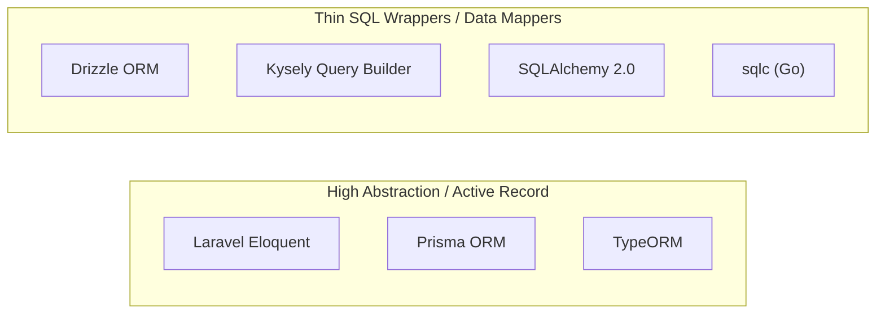

# Modern ORMs & Data Layers: Drizzle, Prisma, Eloquent, and SQLAlchemy (2026)

> Comparative architectural analysis of data access layers, type inference engines, and schema migration strategies.

---

## 1. The ORM Spectrum: Active Record vs Data Mapper vs Thin SQL Wrappers



---

## 2. In-Depth Architectural Comparison

| Dimension | Drizzle ORM | Prisma ORM | Laravel Eloquent | SQLAlchemy 2.0 |
|---|---|---|---|---|
| **Primary Language** | TypeScript | TypeScript / JS | PHP | Python |
| **Philosophy** | "If you know SQL, you know Drizzle" | Schema-first DSL abstraction | Active Record convention-over-configuration | Enterprise Data Mapper & Unit of Work |
| **Engine Footprint** | Pure JS/TS (0 KB binary, edge ready) | Rust Query Engine binary | Pure PHP runtime | C/Rust extensions optional |
| **Cold Start Overhead** | ~1-2 ms | ~50-150 ms (Rust binary boot) | ~5-15 ms (without Octane) | ~10-25 ms |
| **Type Safety** | Pure TS type inference from schema | Generated types via Prisma CLI | IDE docblocks / Laravel Idea | Static types via Mapped and TypeVar |
| **Complex Join Queries** | Direct SQL join mapping | Nested JSON queries (can create N+1 unless optimized) | Eager loading (`with()`) / joins | Explicit join declarations & subqueries |

---

## 3. Concrete Implementations

### 3.1 Drizzle ORM (TypeScript)
Schema is written directly in standard TypeScript without proprietary schema DSL files:

```ts
// schema.ts
import { pgTable, serial, text, timestamp, uuid } from 'drizzle-orm/pg-core';
import { relations } from 'drizzle-orm';

export const organizations = pgTable('organizations', {
  id: uuid('id').defaultRandom().primaryKey(),
  name: text('name').notNull(),
  createdAt: timestamp('created_at').defaultNow().notNull(),
});

export const users = pgTable('users', {
  id: uuid('id').defaultRandom().primaryKey(),
  orgId: uuid('org_id').references(() => organizations.id, { onDelete: 'cascade' }).notNull(),
  email: text('email').notNull().unique(),
  displayName: text('display_name').notNull(),
});

export const organizationsRelations = relations(organizations, ({ many }) => ({
  members: many(users),
}));
```

Query execution:
```ts
import { db } from './db';
import { eq } from 'drizzle-orm';
import { organizations } from './schema';

// Completely type-safe relational query with sub-millisecond execution
const orgWithUsers = await db.query.organizations.findFirst({
  where: eq(organizations.id, 'org_123'),
  with: {
    members: {
      columns: { id: true, email: true },
    },
  },
});
```

### 3.2 Eloquent ORM (Laravel)
```php
// app/Models/Organization.php
namespace App\Models;

use Illuminate\Database\Eloquent\Model;
use Illuminate\Database\Eloquent\Relations\HasMany;

class Organization extends Model
{
    protected $fillable = ['name'];

    public function members(): HasMany
    {
        return $this->hasMany(User::class);
    }
}

// In Controller
$org = Organization::query()
    ->with(['members:id,organization_id,email,display_name'])
    ->findOrFail($orgId);
```
