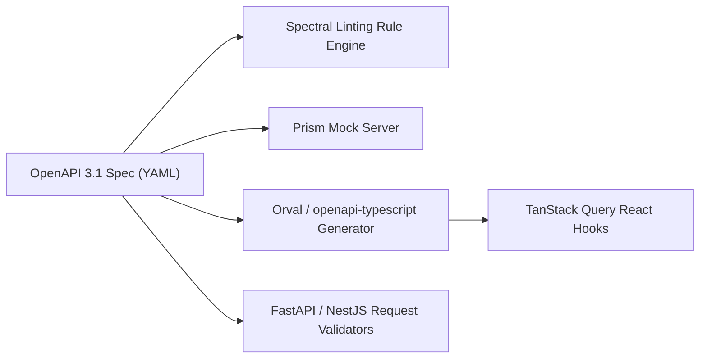

# REST & OpenAPI 3.1: Contract-Driven API Engineering (2026)

> Technical reference for enterprise RESTful design patterns, OpenAPI 3.1 JSON Schema alignment, automated client generation, and Spectral linting.

---

## 1. REST Architectural Invariants & HTTP/3 Semantics

Modern REST adheres strictly to RFC 9110 / RFC 9457 HTTP Semantics:

### 1.1 Standardized Error Representation (RFC 9457 Problem Details)
Eliminates ad-hoc error formats by standardizing application error payloads:

```json
{
  "type": "https://api.example.com/errors/insufficient-funds",
  "title": "Insufficient Funds",
  "status": 403,
  "detail": "Account balance of $25.00 cannot cover transfer of $100.00.",
  "instance": "/accounts/acc_98234/transfers/txn_01284",
  "invalid_params": [
    { "name": "amount", "reason": "Exceeds current available balance" }
  ]
}
```

### 1.2 Pagination Protocols
- **Cursor-Based Pagination (Standard):** Essential for high-velocity real-time data where offset-based pagination (`OFFSET 1000`) suffers from $O(N)$ scanning performance degradation and record-drift duplicates.
  ```http
  GET /api/v1/orders?limit=20&cursor=eyJjcmVhdGVkX2F0IjoxNz...
  ```
  Response contains explicit cursor pagination metadata:
  ```json
  {
    "data": [...],
    "pagination": {
      "has_more": true,
      "next_cursor": "eyJjcmVhdGVkX2F0IjoxNzI4...",
      "limit": 20
    }
  }
  ```

---

## 2. OpenAPI 3.1 & Contract-First Workflow



### 2.1 Spectral Style Enforcement
Automating API governance across engineering teams:

```yaml
# .spectral.yaml
extends: ["spectral:oas"]
rules:
  operation-4xx-response: error
  no-http-verbs-in-paths:
    description: "Endpoints must use nouns, not verbs."
    severity: error
    given: "$.paths[*]~"
    then:
      function: pattern
      functionOptions:
        notMatch: "/(get|create|update|delete).*"
```
