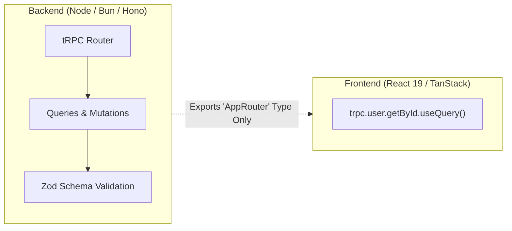

# Type-Safe RPC: tRPC v11 & ConnectRPC for Polyglot Microservices (2026)

> Technical reference for zero-schema TypeScript RPC (tRPC) and protobuf-backed multi-language services (ConnectRPC).

---

## 1. tRPC v11: End-to-End Type Safety Without Codegen

tRPC allows backend procedures to expose their TypeScript type signatures directly to frontend codebases without runtime schemas, code generation steps, or network boilerplate.



### 1.1 Server Definition
```ts
// server/trpc.ts
import { initTRPC, TRPCError } from '@trpc/server';
import { z } from 'zod';

const t = initTRPC.context<{ user?: { id: string; role: string } }>().create();

export const router = t.router;
export const publicProcedure = t.procedure;

export const protectedProcedure = t.procedure.use(async ({ ctx, next }) => {
  if (!ctx.user) throw new TRPCError({ code: 'UNAUTHORIZED' });
  return next({ ctx: { user: ctx.user } });
});

export const appRouter = router({
  getUserById: protectedProcedure
    .input(z.object({ id: z.string().uuid() }))
    .query(async ({ input, ctx }) => {
      return await db.user.findUnique({ where: { id: input.id } });
    }),
});

export type AppRouter = typeof appRouter;
```

---

## 2. ConnectRPC: The Modern Polyglot Alternative to gRPC

While tRPC is strictly TypeScript-to-TypeScript, **ConnectRPC** brings browser-compatible, zero-overhead RPC to multi-language stacks (Go, TypeScript, Python) over HTTP/1.1, HTTP/2, and HTTP/3 without requiring complex Envoy proxies.
