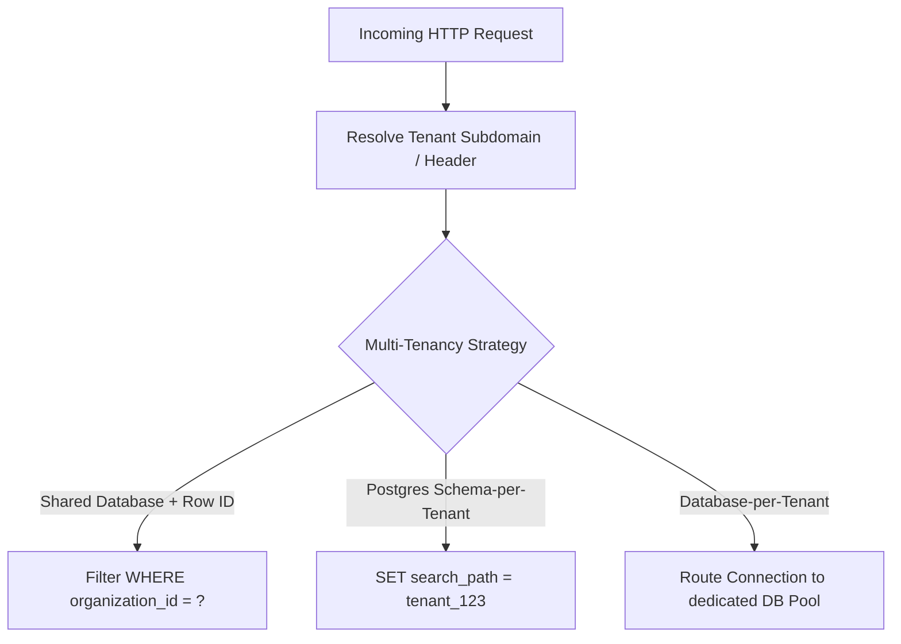

# Zero Trust & Role-Based Access Control (RBAC) Architecture (2026)

> Technical reference for multi-tenant authorization, RBAC vs ABAC models, and session lifecycle security.

---

## 1. Multi-Tenant Isolation Strategies



### Evaluation of Approaches

| Strategy | Operational Complexity | Data Isolation Level | Cost per Tenant | Ideal Scale |
|---|---|---|---|---|
| **Shared Table (`org_id`)** | Minimal | Low (relies on query hygiene or RLS) | Negligible | Millions of free/standard tier users |
| **Schema-per-tenant** | Moderate | High (PostgreSQL schemas) | Low | Thousands of SMB SaaS tenants |
| **Database-per-tenant** | High (connection pooling sprawl) | Complete (Physical isolation) | High | Enterprise tier with strict compliance/HIPAA |

---

## 2. Granular Permissions: RBAC vs ABAC

```ts
// types/rbac.ts
export type Permission = 
  | 'projects:read'
  | 'projects:create'
  | 'projects:delete'
  | 'billing:manage'
  | 'members:invite';

export type Role = 'owner' | 'admin' | 'member' | 'billing_viewer';

export const ROLE_PERMISSIONS: Record<Role, Permission[]> = {
  owner: ['projects:read', 'projects:create', 'projects:delete', 'billing:manage', 'members:invite'],
  admin: ['projects:read', 'projects:create', 'projects:delete', 'members:invite'],
  member: ['projects:read', 'projects:create'],
  billing_viewer: ['billing:manage'],
};
```

Enforcement helper:
```ts
export function hasPermission(userRole: Role, required: Permission): boolean {
  return ROLE_PERMISSIONS[userRole]?.includes(required) ?? false;
}
```
