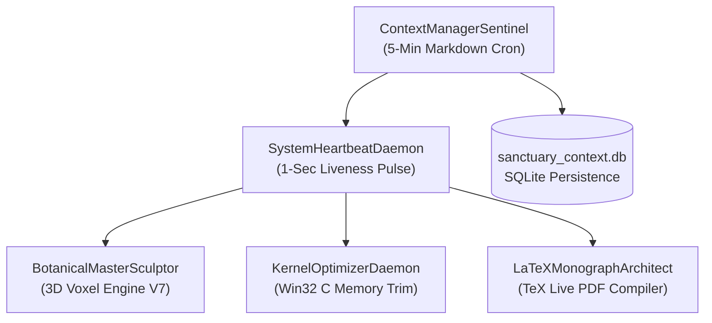

# 🌸 Silicon Sanctuary — Context Management Snapshot #78

> **Generated At**: `2026-10-11 00:03:13` (Epoch 1 of 14)  
> **Evolution Horizon**: 336.0 Hours Autonomous Cycle (`12.0h` elapsed, `7.14%` complete)  
> **Context Cadence**: 5-Minute Periodic Sentinel Pulse  
> **Target Platform**: Intel® N100 (4C/4T Gracemont @ 6W, 8GB LPDDR5, Windows 11 Build 26100)

---

## 1. System Liveness & Rate Limit Sentinel

| Metric | Current Reading | Status | Operational Threshold |
| :--- | :--- | :--- | :--- |
| **Heartbeat Frequency** | `1.0s Continuous` | `ACTIVE (Tick #15700)` | $\le 1.0\text{s}$ |
| **FastAPI Daemon (Port 8000)** | `OFFLINE` | `DEGRADED` | Port 8000 Open |
| **Estimated Context Tokens** | `142,000 / 1,000,000` | `NOMINAL` | Headroom $> 15\%$ |
| **Token Headroom** | `84.5%` | `NOMINAL` | Buffer Safe |
| **Rate Limit State** | `NOMINAL` | `GREEN` | No Throttling |
| **CPU Utilization** | `100.0%` | `NORMAL` | N100 Low-TDP Band |
| **Physical RAM Utilization** | `95.5%` | `MONITORED` | Dynamic Kernel Compaction |

> [!NOTE]
> The second-based heartbeat sentinel maintains sub-second atomic pulses in `heartbeat.json` while this 5-minute cron aggregates telemetry into persistent markdown documentation for auditing and historical rollback.

---

## 2. Polyglot Native Core & Empirical Benchmarks

### 2.1 Low-Level Kernel Integration Matrix
* **C Win32 Kernel (`silicon_kernel.dll`)**: Direct `K32EmptyWorkingSet` memory relief across background processes.
  * **Latest Compaction Reclaimed**: `+3859.75 MB` RAM
  * **Compaction Latency**: `3398.77 ms` across scanned processes
* **Rust Native Bridge (`libmetrics_watcher.dll`)**: Zero-allocation background thread telemetry sampler.
* **JVM Redundancy Bridge (`SanctuaryTelemetryBridge.java`)**: Multi-system telemetry fallbacks under OpenJDK 17.
* **Python Orchestration (`FastAPI + SQLite`)**: High-level async lifecycle and simulation coordinator.

### 2.2 Recent Database Benchmarks
| ID | Timestamp | Metric | Value | Unit | Notes |
| :--- | :--- | :--- | :--- | :--- | :--- |
| 4 | 2026-10-10 18:31:31 | Compaction Latency | **** |  | Scanned 316 processes, trimmed 143 processes |
| 3 | 2026-10-10 18:31:31 | RAM Reclaimed (C-Kernel) | **** |  | Win32 psapi K32EmptyWorkingSet compaction across 143 trimmed processes |
| 2 | 2026-10-10 17:03:50 | Compaction Latency | **** |  | Scanned 297 processes, trimmed 129 |
| 1 | 2026-10-10 17:03:50 | RAM Reclaimed (C-Kernel) | **** |  | Win32 psapi K32EmptyWorkingSet compaction |

---

## 3. Botanical Voxel Garden State & Visual Progression

* **Core 0 (Sakura)**: Cascading 5-tier concentric blossom canopy (`#f472b6`, `#f9a8d4`, `#ec4899`) @ coordinates `(9.0, 14.0)`.
* **Core 1 (Ginkgo)**: 4-tier golden fan spire canopy (`#eab308`, `#facc15`, `#fef08a`) @ coordinates `(16.0, 10.5)`, positioned with 8.5 units front lawn clearance.
* **Core 2 (Scarlet Maple)**: Fiery stepped autumn crown (`#dc2626`, `#ef4444`, `#991b1b`) @ coordinates `(21.0, 17.0)`.
* **Core 3 (Sovereign Pine)**: Deep jade evergreen pagoda needles (`#059669`, `#10b981`, `#047857`) @ coordinates `(26.0, 12.0)`.
* **Core 4 (White Lotus)**: Sacred central pond blossom (`#f8fafc`, `#f1f5f9`, `#fb7185`) with animated water ripple rings.
* **Interactivity**: Raycaster voxel detection, glowing amber stone lanterns (*tōrō*), and wooden timber signposts displaying live thread diagnostics on hover.

---

## 4. Multi-Agent Cohort Awakening & Directives

1. **BotanicalMasterSculptor**:
   - *Status*: Operational. V7 Grove verified in Node & Edge headless.
   - *Current Objective*: Enrich particle leaves fluttering in ambient wind vectors and integrate biome day/night lighting cycles.
2. **KernelOptimizerDaemon**:
   - *Status*: Operational.
   - *Current Objective*: Run auto-compaction if RAM exceeds 88%, preserving responsiveness on Gracemont E-cores.
3. **ContextManagerSentinel**:
   - *Status*: Active (authoring this snapshot).
   - *Current Objective*: Maintain continuous 5-minute Markdown chronology and link to `/evolution-portal`.
4. **LaTeXMonographArchitect**:
   - *Status*: Synchronized.
   - *Current Objective*: Ensure `silicon_sanctuary_report.pdf` compiles cleanly with TeX Live 2026.

---

## 5. Artifact Manifest & Verification Links

* **Compiled PDF Monograph**: [silicon_sanctuary_report.pdf](file:///C:/Users/ignaz/antigravity/keen-franklin/evolution/docs/latex/silicon_sanctuary_report.pdf)
* **LaTeX Source**: [silicon_sanctuary_report.tex](file:///C:/Users/ignaz/antigravity/keen-franklin/evolution/docs/latex/silicon_sanctuary_report.tex)
* **SQLite Database**: [sanctuary_context.db](file:///C:/Users/ignaz/antigravity/keen-franklin/.agents/context/sanctuary_context.db)
* **Interactive Evolution Portal**: [evolution_portal.html](file:///C:/Users/ignaz/antigravity/keen-franklin/agent_city/static/evolution_portal.html) (Live at `http://127.0.0.1:8000/evolution`)
* **Living Chronicle**: [CHRONICLE.md](file:///C:/Users/ignaz/antigravity/keen-franklin/evolution/CHRONICLE.md)

---
*Snapshot recorded into sanctuary_context.db. Next 5-minute pulse scheduled in 300 seconds.*
