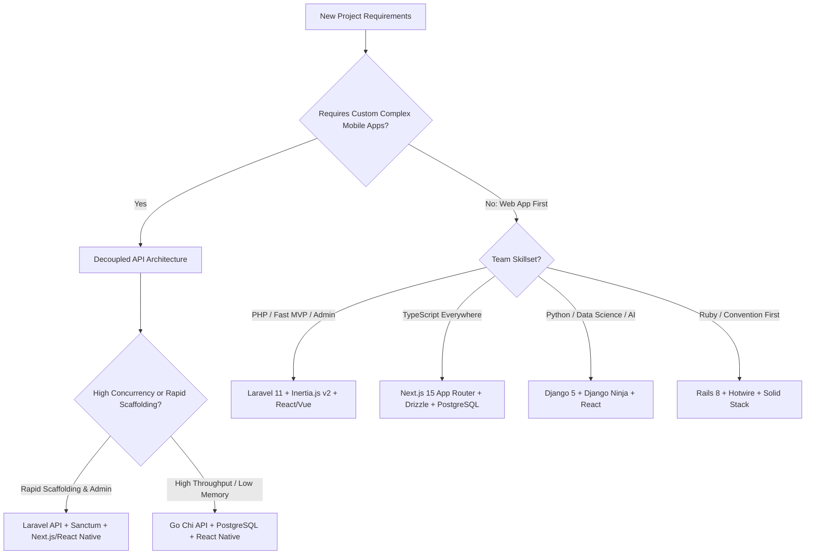

# Open Source Technology Stack Selection Matrix

> Methodological guide for selecting web frameworks, persistence layers, and architectures based on engineering team topology and operational requirements.

---

## 1. Decision Tree Flowchart

---

## 2. Quantitative Scoring Matrix

| Stack | Developer Velocity (1-10) | Peak Throughput (1-10) | Memory Efficiency (1-10) | Admin Tooling (1-10) | Ecosystem Richness (1-10) |
|---|---|---|---|---|---|
| **Laravel + Inertia (React/Vue)** | 10 | 8 (Octane) | 7 | 10 (Filament) | 10 |
| **Next.js + Drizzle ORM** | 8 | 7 | 6 | 6 (shadcn/ui) | 10 |
| **Go (Chi) + sqlc + React SPA** | 5 | 10 | 10 | 3 (Custom) | 8 |
| **FastAPI + SQLAlchemy + React** | 7 | 7 | 7 | 5 (FastAPI Admin) | 9 |
| **Rails 8 + Hotwire (Solid Stack)**| 9 | 6 | 6 | 7 (Avo) | 9 |
