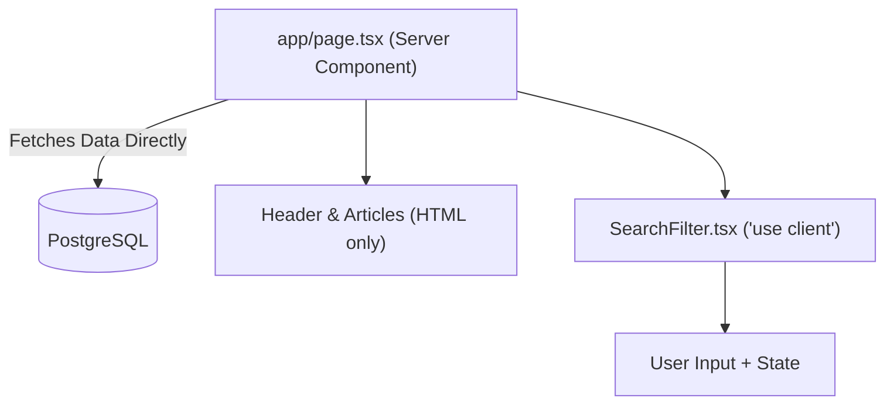

# React 19 Server Components & Actions Architectural Patterns

> Technical reference for React Server Components (RSC), Server Actions, `useActionState`, and `useOptimistic`.

---

## 1. Server Components vs Client Components



- **Server Components (Default):** Can safely execute asynchronous database queries, read filesystem secrets, and import heavy dependencies without bloating the browser bundle.
- **Client Components (`'use client'`):** Hydrate interactive event handlers (`onClick`, `onChange`), browser APIs (`window`, `localStorage`), and state hooks (`useState`, `useReducer`, `useEffect`).

---

## 2. Server Actions with Zod Validation

```tsx
// app/actions/createPost.ts
'use server';

import { z } from 'zod';
import { db } from '@/lib/db';
import { revalidatePath } from 'next/cache';

const CreatePostSchema = z.object({
  title: z.string().min(5, 'Title must be at least 5 characters').max(120),
  content: z.string().min(20, 'Content must be at least 20 characters'),
});

export async function createPost(prevState: any, formData: FormData) {
  const parsed = CreatePostSchema.safeParse({
    title: formData.get('title'),
    content: formData.get('content'),
  });

  if (!parsed.success) {
    return {
      success: false,
      errors: parsed.error.flatten().fieldErrors,
    };
  }

  await db.post.create({
    data: parsed.data,
  });

  revalidatePath('/posts');
  return { success: true };
}
```
