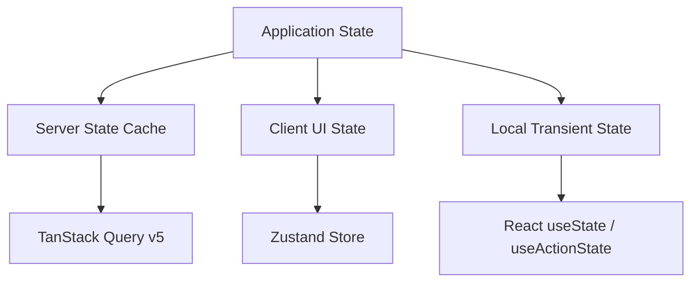

# TanStack Query v5 & Zustand: State Architecture Guide

> Technical reference for managing remote server caches and global client state in modern React applications.

---

## 1. Clean Separation of State Concerns



---

## 2. TanStack Query v5: Optimistic Mutation Pattern

```tsx
import { useMutation, useQueryClient } from '@tanstack/react-query';

interface Todo {
  id: string;
  title: string;
  completed: boolean;
}

export function useToggleTodo() {
  const queryClient = useQueryClient();

  return useMutation({
    mutationFn: async ({ id, completed }: { id: string; completed: boolean }) => {
      const res = await fetch(`/api/todos/${id}`, {
        method: 'PATCH',
        headers: { 'Content-Type': 'application/json' },
        body: JSON.stringify({ completed }),
      });
      if (!res.ok) throw new Error('Failed to update todo');
      return res.json();
    },
    // When mutate is called:
    onMutate: async ({ id, completed }) => {
      // Cancel outgoing refetches so they don't overwrite optimistic update
      await queryClient.cancelQueries({ queryKey: ['todos'] });

      // Snapshot previous value for rollback
      const previousTodos = queryClient.getQueryData<Todo[]>(['todos']);

      // Optimistically update query cache
      queryClient.setQueryData<Todo[]>(['todos'], (old = []) =>
        old.map((todo) => (todo.id === id ? { ...todo, completed } : todo))
      );

      return { previousTodos };
    },
    // If mutation fails, rollback cache to snapshot
    onError: (err, newTodo, context) => {
      if (context?.previousTodos) {
        queryClient.setQueryData(['todos'], context.previousTodos);
      }
    },
    // Always refetch after error or success to synchronize with server
    onSettled: () => {
      queryClient.invalidateQueries({ queryKey: ['todos'] });
    },
  });
}
```

---

## 3. Zustand: Global UI Store with Slice Pattern

```ts
import { create } from 'zustand';
import { devtools, persist } from 'zustand/middleware';

interface ThemeSlice {
  theme: 'light' | 'dark' | 'system';
  setTheme: (theme: 'light' | 'dark' | 'system') => void;
}

interface SidebarSlice {
  isCollapsed: boolean;
  toggleSidebar: () => void;
}

export const useAppStore = create<ThemeSlice & SidebarSlice>()(
  devtools(
    persist(
      (set) => ({
        theme: 'system',
        setTheme: (theme) => set({ theme }),
        isCollapsed: false,
        toggleSidebar: () => set((state) => ({ isCollapsed: !state.isCollapsed })),
      }),
      { name: 'app-storage' }
    )
  )
);
```
